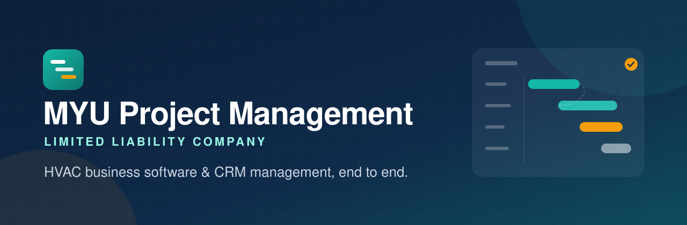

# MYU Project Management LLC — Pitch Deck

> 🖥️ A presentable slide version lives at [`docs/pitch-deck.html`](docs/pitch-deck.html) (arrow keys to navigate).
> We are an early-stage company. This deck describes our thesis and plan, not established traction.

---

### 1 · The problem
Small and mid-sized HVAC contractors run on a patchwork of phone calls, paper tickets,
spreadsheets and disconnected apps. The results:
- missed calls and leads that never get a follow-up,
- double-booked or poorly routed technicians,
- slow invoicing and unpaid balances,
- maintenance customers who are never reminded to come back.

### 2 · Our solution
**One system for the whole job lifecycle, plus the people to run it.**
- **HVAC end-to-end software:** lead → quote → schedule → dispatch → job → invoice → maintenance plan.
- **CRM management:** we set up, clean up and manage the customer database and pipeline so it actually gets used.
- **Customer messaging:** confirmations, on-the-way alerts and reminders by email and opt-in SMS.

### 3 · Why now
- Customers expect text updates and online booking from every service provider.
- Many contractors have outgrown pen-and-paper but find enterprise field-service tools expensive and complex.
- Messaging APIs, cloud hosting and modern CRMs make a focused product affordable to build and run.

### 4 · Who we serve
- **Primary:** owner-operated HVAC companies with roughly 1–25 technicians.
- **Adjacent (later):** plumbing, electrical and other home-service trades with the same workflow.
- **CRM services:** any small business whose customer data is scattered or under-used.

### 5 · Business model (hypotheses we are testing)
| Stream | How it earns |
|---|---|
| HVAC software | Monthly subscription per company / per technician |
| Onboarding | One-time setup, data migration and training fee |
| CRM management | Monthly retainer or project-based fee |
| Messaging | Usage-based pass-through for SMS volume |

### 6 · Go-to-market
1. Direct outreach to local HVAC contractors and pilot customers.
2. Hands-on onboarding — we configure it with them, not just hand over a login.
3. Referrals from satisfied shops; trade associations and supply houses.
4. CRM management engagements as an entry point that leads into the software.

### 7 · Where we are today
- ✅ LLC formed; business identity, website and messaging policies in place.
- 🔄 Customer discovery with HVAC operators.
- 🔄 Defining MVP: scheduling, dispatch, customer messaging and invoicing.
- ⏭️ Next: pilot with first contractors, gather feedback, refine pricing.

### 8 · Roadmap
| Phase | Focus |
|---|---|
| **Now** | Discovery, MVP scope, first CRM management clients |
| **Next** | MVP pilot: booking, dispatch, SMS notifications, invoicing |
| **Later** | Maintenance agreements, reporting, payments, mobile tech app |
| **Beyond** | Expand to adjacent home-service trades |

### 9 · What sets us apart
- **Focused:** built for HVAC workflows, not a generic tool bent to fit.
- **Done-with-you:** software *and* the CRM/process expertise to make it stick.
- **Communication-first:** customer updates are built in, not bolted on.

### 10 · The ask
We're looking for **pilot customers, advisors and partners** in the HVAC and home-services space.
Let's talk → see [Contact](README.md#contact).
