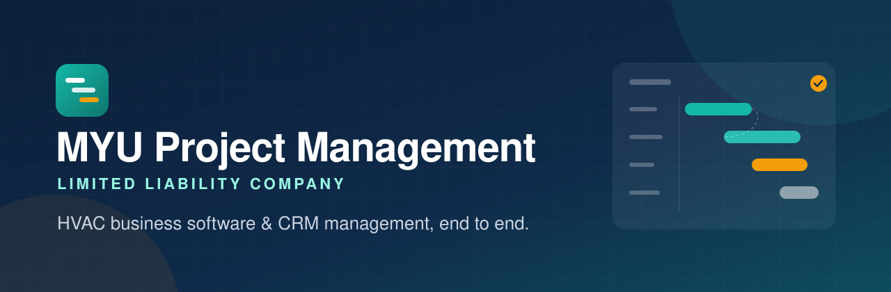
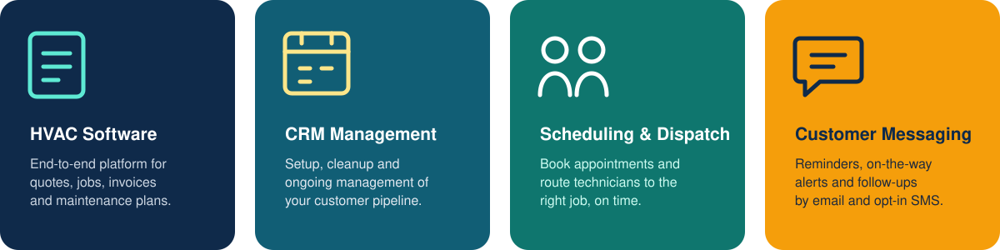

  

  <b>HVAC business software &amp; CRM management, end to end.</b> 
  <a href="#about">About</a> ·
  <a href="#what-we-do">What We Do</a> ·
  <a href="#how-we-work">How We Work</a> ·
  <a href="#client-communications--sms">SMS Communications</a> ·
  <a href="PITCH_DECK.md">Pitch Deck</a> ·
  <a href="#contact">Contact</a>

---

## About

**MYU Project Management LLC** is an early-stage technology and services company. We help
home-service businesses — starting with **HVAC contractors** — run their operations and
customer relationships from one place.

We are in our exploration stage and are actively validating two lines of business:

1. **HVAC end-to-end software** — one platform covering the full job lifecycle, from the first
   customer call to the paid invoice and the next maintenance visit.
2. **CRM management** — setting up, cleaning up and running the customer relationship
   systems small businesses depend on, so leads and repeat customers never fall through the cracks.

This repository is the company's official source of truth and public business website.

| | |
|---|---|
| **Legal name** | MYU Project Management LLC |
| **Entity type** | Limited Liability Company (LLC) |
| **Stage** | Early stage — exploring and validating revenue avenues |
| **Current focus** | HVAC operations software · CRM management |
| **Website** | https://github.com/amanwad/MYU-Project-Management |

## What We Do

  

### 🔧 HVAC end-to-end software
- Lead intake, estimates and quotes
- Appointment scheduling and technician dispatch
- Job tracking, photos and notes from the field
- Invoicing and payment follow-up
- Maintenance agreements and seasonal tune-up reminders
- Reporting on revenue, jobs and technician performance

### 📇 CRM management
- CRM selection, setup and data migration
- Pipeline design for leads, quotes and repeat customers
- Data cleanup and de-duplication
- Automated follow-ups, reminders and review requests
- Ongoing administration, reporting and training

### 💬 Customer messaging
Appointment confirmations, "technician on the way" alerts, service reminders and follow-ups
by email and opt-in text message — sent on behalf of our clients' businesses to customers who asked for them.

## How We Work

  

1. **Discover** — learn how your shop runs today and what tools you already use.
2. **Plan** — agree on scope, timeline and budget in writing.
3. **Build** — configure the software and CRM around your workflow.
4. **Launch** — migrate your data and train your office staff and technicians.
5. **Support** — keep improving based on real usage and results.

## Why MYU

| Principle | What it means for you |
|---|---|
| 🎯 **Built for the trades** | Designed around how HVAC shops actually book, dispatch and bill. |
| 🧩 **One system** | Fewer spreadsheets, sticky notes and disconnected apps. |
| 💬 **Customers stay informed** | Timely reminders and updates reduce no-shows and callbacks. |
| 🔒 **Respect for data** | We collect only what we need and never sell customer information. |

## Client Communications & SMS

MYU Project Management LLC may send text messages to clients and prospective clients who
have **explicitly opted in**. Messages relate to services you requested, such as:

- appointment confirmations and reminders,
- technician arrival ("on the way") notifications,
- service, maintenance and project status updates,
- responses to inquiries you started.

**How to opt in:** by giving us your mobile number and agreeing to receive text messages
(verbally, in writing, or via a form), you consent to receive messages from MYU Project Management LLC.

**Message frequency varies. Message and data rates may apply.**
Reply **STOP** to unsubscribe at any time. Reply **HELP** for help.
Consent to receive text messages is not a condition of any purchase.

**We do not sell, rent or share mobile numbers or SMS opt-in consent with third parties or
affiliates for marketing or promotional purposes.** See our [Privacy Policy](PRIVACY.md)
and [Terms of Service](TERMS.md) for details.

## Documents

- 📄 [Privacy Policy](PRIVACY.md)
- 📄 [Terms of Service](TERMS.md)
- 📊 [Pitch Deck](PITCH_DECK.md) · [slide version](docs/pitch-deck.html)
- 🌐 [Website source](docs/) (GitHub Pages)

## Contact

**MYU Project Management LLC**
- Email: myuprojectmanagement@gmail.com
- Phone: (978)-844-7400
- Mailing address: 8700 Stonebrook Pkwy, Unit 309, Frisco TX, 75034

Questions, partnership ideas or project inquiries are welcome.

---

   
  © 2026 MYU Project Management LLC. All rights reserved.

